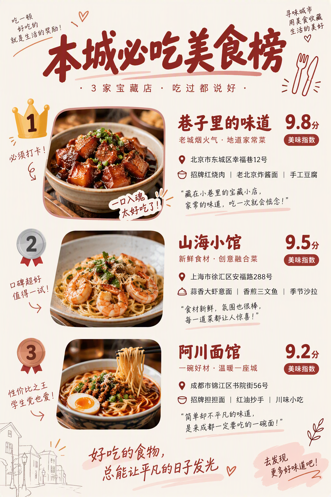
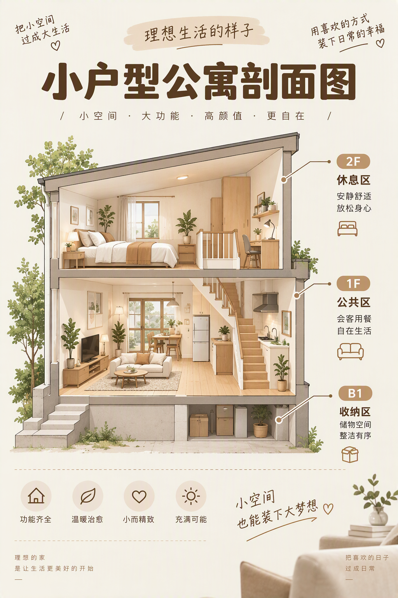
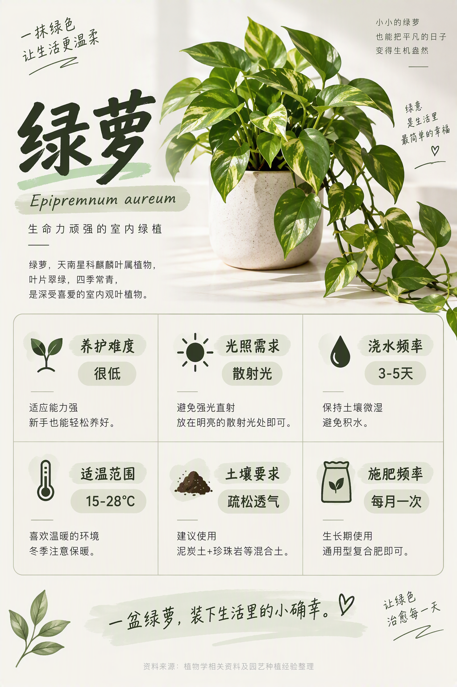
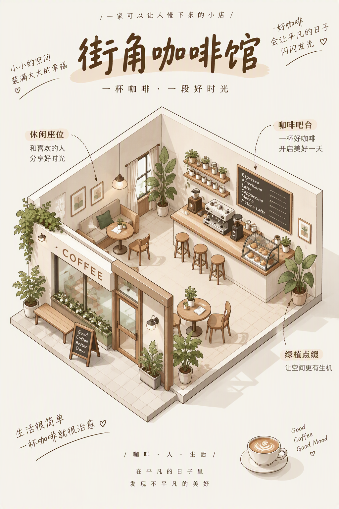

# 小红书做图提示词库（xhs-prompt-library）

把小红书信息图拆成 **9 个可组合维度**（形态 × 封面 × 排版 × 风格 × 主题色 × 尺寸 × 配色 × 字体 × 装饰），像选配方一样组合出图。纯静态网页，无需联网、无需密钥。

**🌐 在线使用：https://gaoren7716-lab.github.io/xhs-prompt-library/**（也可下载后双击 `index.html` 离线使用）

## 示例画廊（40 张真实出图，逐张目视校验）

全部由本库提示词直接出图，**中文文案零错字**。网页里点任意一张可展开完整提示词、配方码与复现要点。

| | | |
| --- | --- | --- |
|  |  |  |
| 清单列表 · 密集模块 | 拼贴合集 · 九宫格 | 排行榜 · TOP3 实拍 |
|  |  |  |
| 分层结构 · 同心圆 | 前后对比 · 改造 | 引号金句 · 关键词放大 |
|  |  |  |
| 讲义式高密 · 编号卡片 | 地图标注 · 四地点 | 剖面截面 · 三层公寓 |
|  |  |  |
| 百科全书式 · 六模块 | 图鉴式 · 商业摄影级 | 等距轴测 · 微缩咖啡馆 |

覆盖：封面类型 **10/10**、内容形态 **10/10**、版式 **40/165**、主题色 **21/36**。

## 网页八页

| 页签 | 用途 |
| --- | --- |
| ★ 示例画廊 | 40 张真实出图，点图展开提示词，一键复制（自带尺寸参数） |
| ★ 自定义出图 | 选题预设 → 填主题 → 自动配维度 → 复制提示词 |
| 提示词合成器 | 选 9 个维度实时拼提示词；派生位自动跟随，配方存 localStorage |
| 验证案例 | 5 个案例全文，含验证点 |
| 全部词条 | 80 条 prompt 片段，按维度切换 |
| 抽卡 | 各维度随机组合，可一次铺 8 组 |
| 风格配色搭配 | 12 组场景的风格 × 主题色参考 |
| 框架与体检 | 决策归属表、覆盖矩阵、冲突裁决 |

## 出图怎么用

复制提示词（已自带 `1024×1536` 尺寸与硬约束）→ 粘到任意文生图工具出图。本库只出提示词，不代调模型。

## 扩展与验证

```bash
node tools/build_web.js        # 改 data/*.json 后重新打包
node tools/check_cases.js      # 结构体检（1340 项）
NODE_PATH=<jsdom> node tools/smoke-web.js   # 界面冒烟（80 项）
node tools/check_copy.js       # 查重（防抄袭，≥5 字比对）
```

当前基线：**体检 1340 全绿 + 冒烟 80 全绿 + 查重 0 雷同**。

关键约定（详见 `FRAMEWORK.md`）：

- **命名**：网页维度键一律单数（`form`），数据表一律复数（`forms`），靠 `DATA_OF` 互转 —— 写混会整页白屏，只有冒烟测得出。
- **决策归属**：form / size / style 是自主决策位，cover / layout / palette 是派生位（自动跟随，可手动锁定）。
- **素材授权红线**：7 条机器查不了的法律类条目独立成 `data/rights.json`，画廊详情页常驻。

## 已知缺口

- 版式覆盖 40/165，主题色 21/36，持续补画廊。
- 缺行业垂直模板（穿搭/美食/旅行/美妆）与 A/B 封面模板库。
